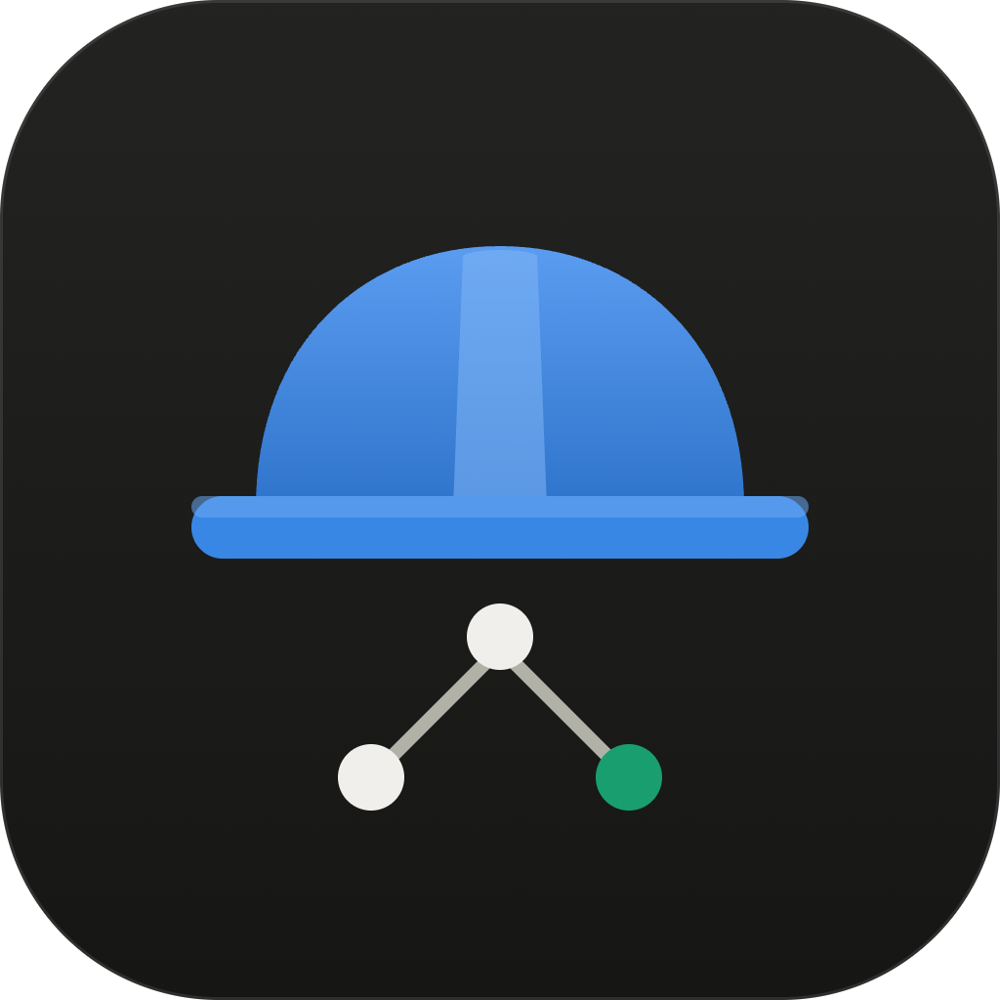
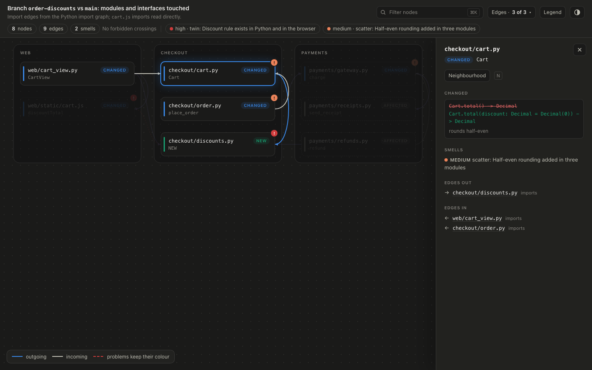
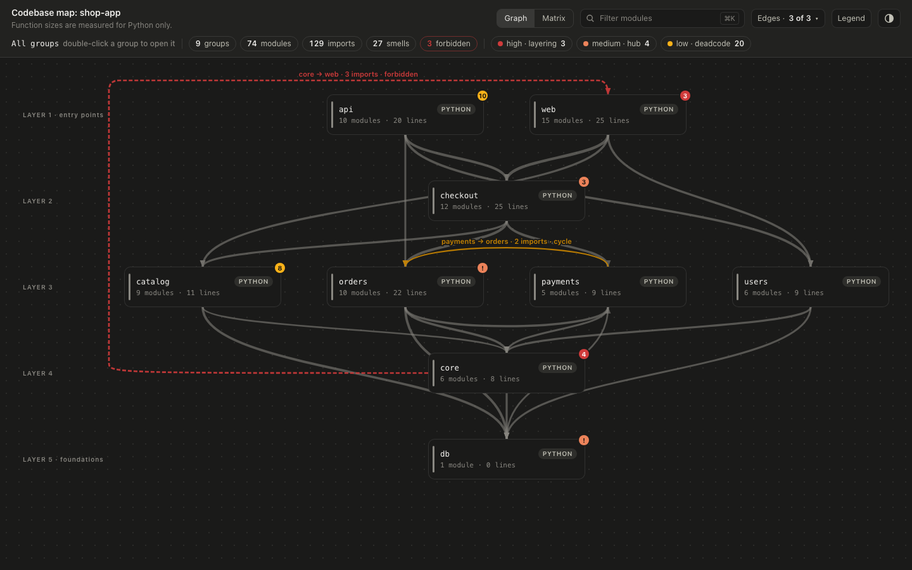

# foreman


Human-on-the-loop review for AI coding agents: hard-tests every change and maps architecture and code smells at a glance.

Agents write more code than a person can read line by line. foreman keeps you on the loop
without that: evidence (the repo's tests, plus, for user-facing changes, the app driven in a
real browser on the base branch and on your change), structure at a glance (a dependency diagram and a codebase map
with smells marked), and a short ranked list of what needs your judgement.





## Install

Claude Code:

```
/plugin marketplace add LeonP92/foreman
/plugin install foreman@foreman
```

Codex:

```
codex plugin marketplace add LeonP92/foreman
codex plugin add foreman@foreman
```

## Commands

| Command | What it does |
|---|---|
| `/foreman:setup` | Learns how the repo is built, tested, served and seeded; writes `.foreman/config.toml`. |
| `/foreman:review` | Pre-merge gate for a branch: design findings, tests, browser check for user-facing changes, diagram, one ranked report. |
| `/foreman:verify` | Drives the app in a real browser on base and change side by side, on copied data only. |
| `/foreman:diagram` | Interactive dependency diagram of the modules a branch changes and their neighbours. |
| `/foreman:audit` | Sweeps the base branch for structural smells and draws a dependency-ordered codebase map. |

Config reference: [docs/config.md](docs/config.md). Smell catalogue: [docs/smells.md](docs/smells.md).

## Requirements

Python 3.11+ and git. Node 20+ only for `verify` and the UI smoke pass.

## Languages

Python, JS/TS and Go are graphed out of the box. Any other language gets an import rule
that `setup` writes after reading a few of your files.

## License

[MIT](LICENSE). Inspired by [ponytail](https://github.com/DietrichGebert/ponytail) (MIT); credit for ideas only.
